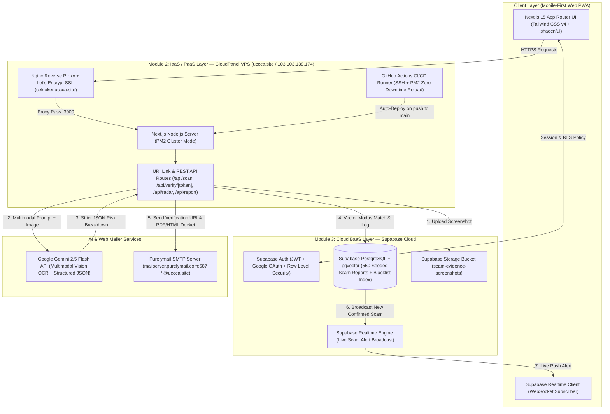
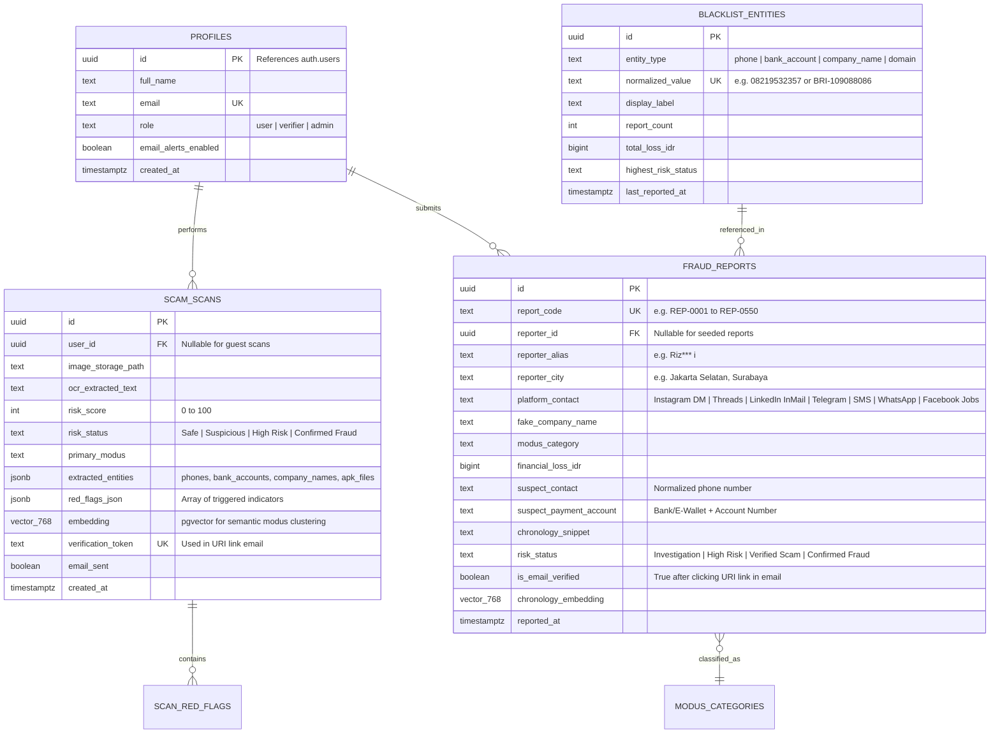

 # CekLoker.ai — Cloud Computing Tech Stack & Architecture Specification

> [!IMPORTANT]
> **Course Alignment (`20261_IMT01306609-A` Cloud Computing A)**
> This architecture is engineered to achieve 100% compliance across all four grading pillars in the Semester Learning Plan (RPS):
> - **Module 2 — IaaS & PaaS (40% AFL 2)**: Self-hosted Next.js 15 production deployment on **CloudPanel VPS (`uccca.site` / `103.103.138.174`)** with Nginx Reverse Proxy, PM2 cluster process management, SSL/TLS, custom URI link routing, and **Purelymail SMTP (`mailserver.purelymail.com:587`)** web mailer integration.
> - **Module 3 — Backend as a Service / BaaS (20% AFL 3)**: Full **Supabase** stack featuring **PostgreSQL + `pgvector`**, **Supabase Auth (RLS)**, **Supabase Storage**, and **Supabase Realtime WebSockets**.
> - **Module 4 — Final Project / ALP (25% ALP)**: Multimodal AI Scam Triage using **Google Gemini 2.5 Flash Vision API** with strict JSON schema output + Crowdsourced Intelligence Radar seeded with **550 empirical victim reports** (`src_1792117531508_loker_tab4.txt`) and **15 verified police/media case studies**.

---

## 1. End-to-End Cloud Architecture Diagram

---

## 2. Layer-by-Layer Technology Stack

### A. Frontend & Application Framework
| Component | Technology | Version / Spec | Justification |
| :--- | :--- | :--- | :--- |
| **Framework** | **Next.js (App Router)** | `15.x` (React 19, TypeScript 5) | Unified full-stack framework supporting Server Actions, SSR for SEO-indexed scam reports, and API routes. |
| **Styling & UI** | **Tailwind CSS + shadcn/ui** | Tailwind `v4` + Radix Primitives | Mobile-first responsive UI with accessible dark/light mode tokens and high-contrast warning badges. |
| **State & Validation** | **Zod + React Hook Form** | `zod ^3.24` | End-to-end schema validation shared between client forms, API routes, and Gemini structured JSON output. |
| **Data Visualization** | **Recharts + Lucide Icons** | `recharts ^2.15` | Renders real-time scam modus distribution charts, city heatmaps, and risk gauge meters. |

### B. Module 2: Cloud IaaS & PaaS Infrastructure (40% Course Weight)
| Component | Technology | Configuration | Course Requirement Fulfilled |
| :--- | :--- | :--- | :--- |
| **Cloud VPS Server** | **CloudPanel on Ubuntu Linux** | IP: `103.103.138.174` (`uccca.site`) | **IaaS / PaaS Server Management**: Self-managed virtual private server with SFTP, firewall rules, and vhost isolation. |
| **Reverse Proxy & Domain** | **Nginx + Let's Encrypt TLS** | Subdomain: `https://cekloker.uccca.site` | **URI Link Implementation**: Clean subdomain routing, HTTPS termination, and dynamic verification URI endpoints (`/verify/[scan_id]`). |
| **Process Manager** | **PM2** | `ecosystem.config.js` (Cluster mode, auto-restart) | Ensures high availability, log rotation, and zero-downtime reloads on the VPS. |
| **CI/CD Pipeline** | **GitHub Actions** | `.github/workflows/deploy.yml` | **Week 6 CI/CD Implementation**: Automated lint, build, and SSH deployment to CloudPanel upon pushing to `Gee123a/cekloker-ai` (`main`). |
| **Web Mailer & SMTP** | **Purelymail SMTP + Nodemailer** | Host: `mailserver.purelymail.com`, Port: `587` (STARTTLS), Sender: `no-reply@uccca.site` / `ivan@uccca.site` | **Week 5 & 7 Web Mailer + URI Link**: Dispatches interactive HTML Scam Triage Dockets (Light/Dark Mode resilient) containing unique verification links (`/verify/[token]`) to confirm user reports or alert subscribers. |

### C. Module 3: Cloud Backend-as-a-Service / BaaS (20% Course Weight)
| Supabase Service | Implementation Details | Security & Performance Spec |
| :--- | :--- | :--- |
| **1. Supabase PostgreSQL** | Primary relational store for `profiles`, `scam_scans`, `fraud_reports`, `blacklist_entities`, and `modus_clusters`. | Indexed on `suspect_contact`, `suspect_payment_account`, and `fake_company_name` using B-Tree and GIN trigram (`pg_trgm`) indexes for `< 25ms` fuzzy lookup. |
| **2. Supabase `pgvector`** | Stores 768-dimensional text embeddings (`text-embedding-004`) of scam chronologies and OCR transcripts. | Enables **Semantic Modus Clustering** (`<=>` cosine distance) to match newly uploaded screenshots against historical fraud tactics. |
| **3. Supabase Authentication** | Email/Password + Google Workspace OAuth2 login. | Enforces PostgreSQL **Row Level Security (RLS)**: anonymous users can run triage scans and search public blacklists; authenticated users manage personal scan history and submit verified reports. |
| **4. Supabase Storage** | Dedicated bucket `scam-evidence` for WhatsApp/Telegram chat screenshots and job flyers. | Signed upload URLs, MIME-type restriction (`image/png`, `image/jpeg`, `image/webp`), max 5 MB per file, automatic PII blurring option. |
| **5. Supabase Realtime** | Postgres Changes broadcast channel (`public:fraud_reports`). | Streams newly verified scam reports and trending modus spikes live to all connected browsers without page refresh. |

### D. AI & Intelligence Engine (Multimodal Vision + Semantic Clustering)
| Component | Model / Library | Role in CekLoker.ai |
| :--- | :--- | :--- |
| **Multimodal Vision & OCR** | **Google Gemini 2.5 Flash** (`@google/genai`) | Extracts text from noisy screenshots (WhatsApp chats, Telegram groups, Instagram flyers) and evaluates psychological manipulation markers. |
| **Structured Output** | **Gemini `responseSchema` (Strict JSON)** | Guarantees deterministic output: `risk_score` (0–100), `risk_level` (`Low`, `Medium`, `High Risk`, `Confirmed Fraud`), `detected_modus`, `red_flags[]`, `extracted_entities` (phone, bank account, company name, APK filename), and `recommended_actions[]`. |
| **Semantic Embeddings** | **Gemini `text-embedding-004`** | Generates 768-d vectors stored in Supabase `pgvector` to cluster novel scam scripts with the 550 empirical cases. |

---

## 3. Database Schema & Entity-Relationship Diagram

---

## 4. URI Link & Web Mailer Workflow (Connecting Module 2 & Module 3)

To directly integrate **Week 5–7 (Web Mailer + Backend URI Link Implementation)** into the Final Project:
1. **Scan Docket Email Delivery (`/api/scan/send-docket`)**:
   - After scanning a suspicious job poster or chat, the user can enter their email to receive an official **CekLoker.ai Security Docket** via Purelymail SMTP (`no-reply@uccca.site`).
   - Includes a persistent **URI Verification Link** (`https://cekloker.uccca.site/docket/[scan_id]`) so the user can share the verified warning link with family or university career centers.
2. **Crowdsourced Report URI Confirmation (`/api/report/verify?token=[token]`)**:
   - When a victim submits a new fraud report to the Crowdsourced Intelligence Radar, the backend stores the report with `is_email_verified = false` and sends a confirmation email via Purelymail SMTP.
   - Clicking the **URI Link** (`https://cekloker.uccca.site/api/verify?token=...`) flips `is_email_verified = true`, increments the `BLACKLIST_ENTITIES` counter in Supabase PostgreSQL, and triggers a **Supabase Realtime** broadcast to all active users.
